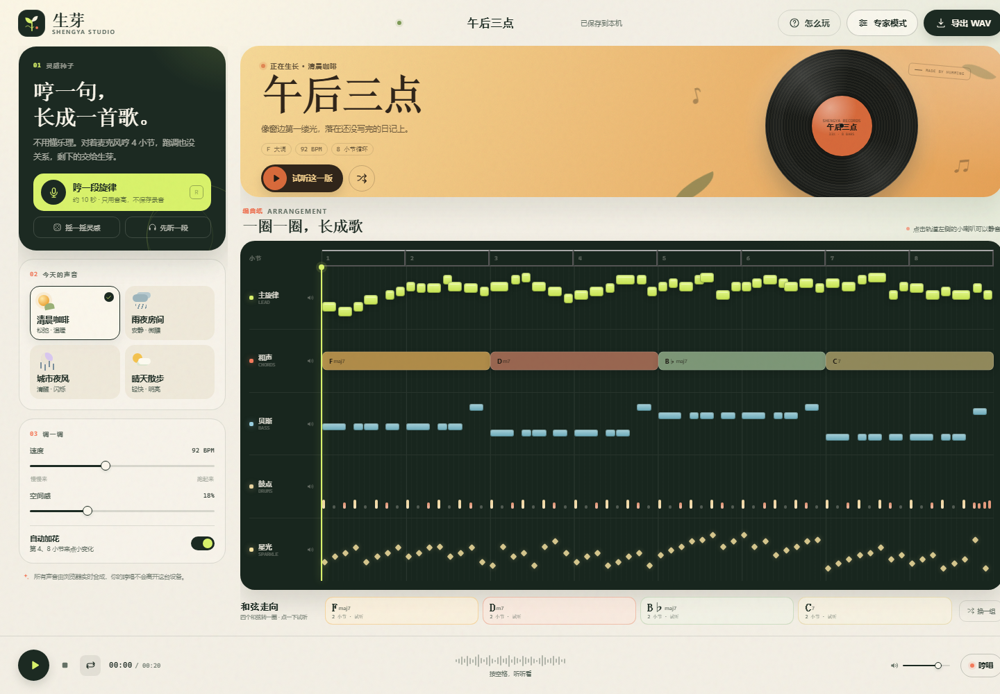
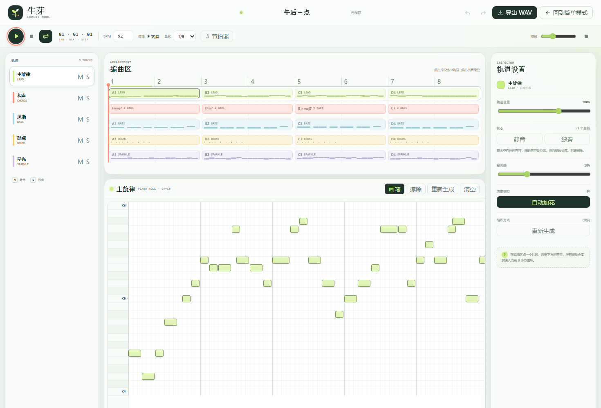

# 生芽 · Shengya Studio

> 这是 GitHub Pages 专用版本。发布步骤见同目录的 **[GITHUB-PAGES.md](GITHUB-PAGES.md)**。

一个给普通人用的浏览器音乐工作室：**哼 4 小节，自动长成一首有鼓点、贝斯、和弦和旋律的 8 小节小曲，并导出 WAV。**

不用懂乐理，不用装宿主软件。所有声音由 Web Audio 实时合成，哼唱只在本机被分析成音高，不上传、不保存录音。



## 两种模式

- **简单模式**：默认打开。哼唱、选情绪、摇一摇，适合快速把一个念头变成歌。
- **专家模式**：点右上角「专家模式」。完整 DAW 布局：轨道列表、编曲区、钢琴卷帘 / 鼓机 / 和弦轨、检查器、走带控制、撤销重做。适合想自己动手改每一个音的人。



## 怎么打开

### 方式一：双击

双击 **`启动生芽.cmd`**，等待浏览器自动打开 `http://127.0.0.1:4173/`。

### 方式二：命令行

```powershell
node server.mjs
```

然后打开 <http://127.0.0.1:4173/>。

> 不要直接双击 `index.html`。浏览器会限制 `file://` 页面使用麦克风，`start.ps1` 会启动一个本地小服务，让哼唱功能正常工作。

需要 Node.js 18+。Chrome / Edge 的最新版本效果最好。

## 能做什么

- **哼唱成曲**：跟着四拍预备哼 4 小节，自动做音高检测、节拍量化、音阶校准，再扩展成 8 小节循环。
- **四种声音**：清晨咖啡、雨夜房间、城市夜风、晴天散步。每次切换会换掉速度、调性、和弦、鼓组和音色。
- **自动编曲**：主旋律、和声、贝斯、鼓点、星光五条轨道，可以单独静音、独奏、调音量。
- **专家模式**：5 轨编曲区 + 钢琴卷帘画音符、鼓机 128 步、和弦轨改根音与性质、轨道检查器、撤销 / 重做。
- **一键变化**：摇一摇灵感、换一段旋律、换一组和弦、自动加花。
- **实时播放**：8 小节循环，点击小节号可以跳转，空格播放 / 暂停；专家模式支持节拍器。
- **导出 WAV**：实时录制一遍当前编曲（含混响与延迟）并下载为 16-bit WAV，录制时长与歌曲相同。
- **自动保存**：作品存在浏览器 `localStorage` 里，关掉页面再回来还在。

## 快捷键

| 键 | 作用 |
| --- | --- |
| `空格` | 播放 / 暂停 |
| `R` | 打开哼唱（简单模式） |
| `Ctrl/⌘ + Z` | 撤销（专家模式） |
| `Ctrl/⌘ + Shift + Z` | 重做（专家模式） |
| `Esc` | 关闭弹窗 / 退出专家模式 |

## 文件结构

```text
shengya-studio/
├─ index.html      页面结构 + SVG 图标（简单模式 / 专家模式）
├─ styles.css      纸张、黑胶、编曲纸的视觉样式
├─ expert.css      专家模式的清新 DAW 界面
├─ app.js          乐理生成、Web Audio 合成器、哼唱识别、WAV 导出
├─ expert.js       专家模式：钢琴卷帘、鼓机、和弦轨、检查器、撤销
├─ server.mjs      零依赖静态服务器
├─ start.ps1       Windows 启动脚本（自动找 Node）
├─ preview/        桌面端、移动端、专家模式预览图
└─ 启动生芽.cmd     双击入口
```

## 隐私说明

- 麦克风音频只在浏览器内存里做实时音高分析，录音不会被保存或发送。
- 作品数据保存在本机 `localStorage`，键名 `shengya-studio-state-v1`（会兼容读取旧的 `sprout-studio-state-v1`）。
- 页面没有外部字体、统计脚本或网络请求。

## 一些实现说明

- 合成器全部手写：底鼓、军鼓、踩镲、拍手、贝斯、Pad、和弦 Stab、Pluck、主音，外加多抽头空间混响和附点延迟。
- 哼唱识别使用 YIN 风格的累积均值归一化差值函数，再做中值平滑和音阶吸附。
- 自动旋律用可复现的种子随机生成，强拍落和弦音、弱拍走音阶，最后落到终止和弦。
- 导出通过 `ScriptProcessorNode` 实时抓取主输出，再编码成 44.1kHz / 16-bit / 立体声 WAV；因为要完整录一遍，等待时间约等于歌曲长度。
